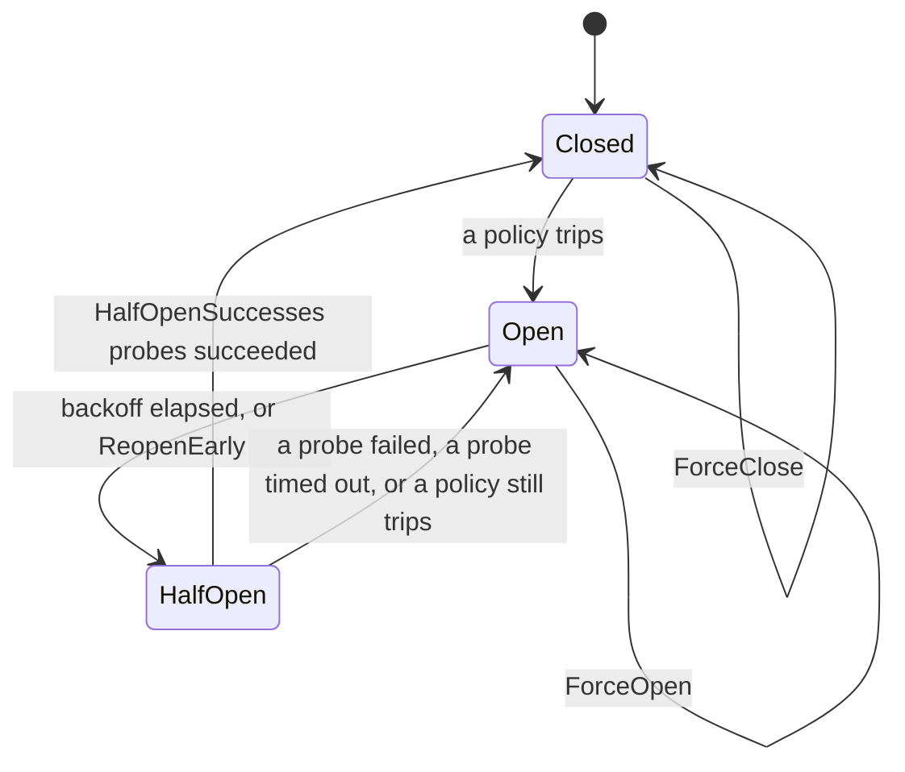

# go-circuitbreakerlib

[](https://github.com/barnowlsnest/go-circuitbreakerlib/actions/workflows/build.yml)
[](https://github.com/barnowlsnest/go-circuitbreakerlib/actions/workflows/golangci-lint.yml)
[](https://pkg.go.dev/github.com/barnowlsnest/go-circuitbreakerlib)
[](https://goreportcard.com/report/github.com/barnowlsnest/go-circuitbreakerlib)
[](LICENSE)

A circuit breaker for Go services that call remote dependencies over HTTP,
gRPC, or TCP. The core state machine has no dependencies and allocates
nothing on the hot path. Around it: a keyed registry, composite breakers
that open a parent when enough of its children are down, one adapter per
protocol, and hooks for logging and metrics.

**Status:** v0. The exported API may change between minor versions until
the adapters have run in a real gateway.

## Installation

```bash
go get github.com/barnowlsnest/go-circuitbreakerlib
```

Requires Go 1.27 or later.

## Packages

| Package                                  | What it holds                                                                     | Imports                          |
|------------------------------------------|-----------------------------------------------------------------------------------|----------------------------------|
| [`pkg/breaker`](pkg/breaker/doc.go)      | `Breaker`, `Permit`, windows, policies, backoff, `Events`, `Execute`, `Do`        | standard library only            |
| [`pkg/hooks`](pkg/hooks/doc.go)          | `LogEvents` (go-logslib, rate-limited) and `MultiEvents`                          | go-logslib, `x/time/rate`        |
| [`pkg/registry`](pkg/registry/doc.go)    | one breaker per key, bounded with sampled eviction                                | `breaker`                        |
| [`pkg/composite`](pkg/composite/doc.go)  | parent over children, `Lease`, `Pick`, `FromHierarchy`                            | `breaker`, go-datalib `tree`     |
| [`pkg/adapter`](pkg/adapter/doc.go)      | `http.RoundTripper`, gRPC client interceptors, `net` dialer with tracked conns    | `breaker`, `registry`, grpc      |

Every code block below is copied from an `Example` function that `go test`
compiles and runs.

## Quick start

One breaker per host behind an `http.Client`:

```go
// One breaker per host, created on first use.
hosts, err := registry.New(
	registry.WithBreaker(
		breaker.WithPolicies(breaker.FailureRate{Threshold: 0.5, MinCalls: 20}),
		breaker.WithOpenDuration(30*time.Second),
	),
)
if err != nil {
	panic(err)
}
transport, err := adapter.NewHTTPRoundTripper(nil, adapter.WithRegistry(hosts))
if err != nil {
	panic(err)
}
client := &http.Client{Transport: transport, Timeout: 5 * time.Second}
```

When a host's breaker is open, `client.Do` returns a `*breaker.RejectedError`
without sending the request; `errors.Is(err, breaker.ErrOpen)` is true.

## Core

### States

A breaker is **Closed** (calls pass and are counted), **Open** (calls are
rejected until the backoff elapses), or **HalfOpen** (a bounded number of
probe calls pass; their outcomes decide whether the breaker closes or
opens again).



`ForceOpen`, `ForceClose`, and `Reset` override the machine from outside.

### Permits

`Allow` returns a `Permit` or a rejection. `Record` takes the permit back
with an `Outcome` and the elapsed time. A permit carries the epoch it was
issued in; a permit from before a state change is discarded on `Record`, so
a slow response from before the breaker opened cannot close it.

```go
p, err := b.Allow()
if err != nil {
	return err // *breaker.RejectedError
}
start := time.Now()
err = call()
b.Record(p, classify(err), time.Since(start))
```

`Execute` and `Do` do that for you, classify with `WithClassifier`, and
record in a `defer`, so a panicking function records a failure before the
panic propagates:

```go
b, err := breaker.New(breaker.WithName("inventory"))
if err != nil {
	panic(err)
}
err = b.Execute(context.Background(), func(ctx context.Context) error {
	return errors.New("upstream unavailable")
})
fmt.Println(err, b.State())
// Output: upstream unavailable closed
```

```go
b, err := breaker.New(breaker.WithName("pricing"))
if err != nil {
	panic(err)
}
price, err := breaker.Do(context.Background(), b, func(ctx context.Context) (int, error) {
	return 1999, nil
})
fmt.Println(price, err)
// Output: 1999 <nil>
```

### Configuration

```go
b, err := breaker.New(
	breaker.WithName("payments"),
	breaker.WithWindow(breaker.SlidingTimeWindow{Size: 10 * time.Second, Buckets: 10}),
	breaker.WithPolicies(
		breaker.FailureRate{Threshold: 0.5, MinCalls: 20},
		breaker.ConsecutiveFailures{Count: 5},
	),
	breaker.WithBackoff(breaker.ExponentialBackoff{Base: 5 * time.Second, Max: time.Minute, Jitter: true}),
	breaker.WithSlowCallDuration(2*time.Second),
	breaker.WithHalfOpenMaxCalls(1),
)
if err != nil {
	panic(err)
}
fmt.Println(b.Name(), b.State())
// Output: payments closed
```

| Option                    | Default                                                     | Meaning                                                                                                                                      |
|---------------------------|-------------------------------------------------------------|----------------------------------------------------------------------------------------------------------------------------------------------|
| `WithName`                | required                                                    | Appears in events, log lines, and `RejectedError`.                                                                                           |
| `WithWindow`              | `SlidingTimeWindow{Size: 10s, Buckets: 10}`                 | What the policies look at. `SlidingCountWindow{Size: n}` keeps the last `n` calls instead.                                                   |
| `WithPolicies`            | `FailureRate{0.5, 20}` and `ConsecutiveFailures{5}`         | Any policy that trips opens the breaker. Run after every Closed record and once more on the record that would close a HalfOpen breaker.     |
| `WithBackoff`             | `ConstantBackoff(OpenDuration)`                             | How long Open lasts on attempt `n`. `ExponentialBackoff{Base, Max, Jitter}` doubles per attempt.                                             |
| `WithOpenDuration`        | `30s`                                                       | The constant backoff when `WithBackoff` is unset.                                                                                            |
| `WithHalfOpenMaxCalls`    | `1`                                                         | Probe calls in flight at once while HalfOpen. More are rejected with `ErrTooManyProbes`.                                                     |
| `WithHalfOpenSuccesses`   | `HalfOpenMaxCalls`                                          | Successful probes needed to close.                                                                                                           |
| `WithProbeTimeout`        | `60s`                                                       | A probe not recorded within this time is treated as failed and the breaker opens again. Must be at least your request timeout.               |
| `WithSlowCallDuration`    | `0` (off)                                                   | A success slower than this counts as slow, for `SlowCallRate`.                                                                               |
| `WithClassifier`          | `DefaultClassifier`                                         | Maps `(ctx, err)` to an outcome for `Execute` and `Do`. The default ignores `context.Canceled` and counts every other error, deadlines included, as a failure. |
| `WithEvents`              | `NoopEvents`                                                | Observer for transitions, calls, rejections, and hook panics.                                                                                |
| `WithReopenEarly`         | nil                                                         | Checked on every `Allow` while Open; returning true moves to HalfOpen before the backoff elapses. Used by composites.                       |
| `WithClock`               | `time.Now`                                                  | Injected in tests.                                                                                                                           |

`New` returns `ErrInvalidConfig` joined with the specific sentinel
(`ErrEmptyName`, `ErrNegativeDuration`, `ErrWindowSize`, ...), so
`errors.Is` matches either.

### Policies

| Policy                                   | Trips when                                                        |
|------------------------------------------|-------------------------------------------------------------------|
| `FailureRate{Threshold, MinCalls}`       | at least `MinCalls` in the window and failures/total ≥ `Threshold` |
| `SlowCallRate{Threshold, MinCalls}`      | same, over slow calls                                             |
| `ConsecutiveFailures{Count}`             | the last `Count` outcomes were failures                           |
| `FailureCount{Count}`                    | at least `Count` failures in the window                           |

A `Policy` is `ShouldTrip(Counts) bool` plus `Name()`; the name becomes the
transition's `Reason`.

### Half-open probes and `ProbeTimeout`

While HalfOpen, `Allow` hands out at most `HalfOpenMaxCalls` probe permits.
Each probe has a slot with its own deadline. If a probe is never recorded,
because the caller leaked it or the request hung, the slot expires after
`ProbeTimeout` and the breaker opens again with the next attempt's backoff.
Set `ProbeTimeout` to at least the longest request timeout you use behind
the breaker, or a slow but healthy probe is counted as a failure.

### Events

Hooks run on the calling goroutine after the breaker lock is released, so
they must not block. Every hook runs under `recover`; a panic is counted in
`HookPanics()` and reported through `OnHookPanic`. Embed `NoopEvents` to
implement only the hooks you need:

```go
// metricsEvents forwards breaker events to a metrics client. Hooks run on
// the calling goroutine after the breaker lock is released, so they must
// not block: counters are incremented here and exported elsewhere.
type metricsEvents struct {
	breaker.NoopEvents
	transitions map[string]int
	rejections  map[string]int
}

func (m *metricsEvents) OnStateChange(ev breaker.StateChangeEvent) {
	m.transitions[ev.Name+":"+ev.To.String()]++
}

func (m *metricsEvents) OnReject(ev breaker.RejectEvent) {
	m.rejections[ev.Name]++
}
```

The breaker fires every event, with exact counts. Rate limiting belongs in
the hook, which is what `LogEvents` does.

## Hooks

`hooks.NewLogEvents` logs through [go-logslib](https://github.com/barnowlsnest/go-logslib)
with fixed levels: a transition into Open is `ERROR`, any other transition
`INFO`, a failure or slow call `WARN`, a rejection `WARN`, a success
`DEBUG`. Rejections and failures are rate-limited per breaker, one line per
period, carrying the number of lines suppressed since the last one.

```go
// Log lines carry timestamps, so they go to stderr here to keep the
// example's output stable. In a program use the logger you already have.
log := logger.New(logger.Config{
	Level:  logger.InfoLevel,
	Format: logger.TextFormat,
	Output: os.Stderr,
})
events, err := hooks.NewLogEvents(log,
	hooks.WithRejectEvery(5*time.Second),
	hooks.WithFailureEvery(time.Second),
)
if err != nil {
	panic(err)
}
b, err := breaker.New(
	breaker.WithName("payments"),
	breaker.WithPolicies(breaker.ConsecutiveFailures{Count: 1}),
	breaker.WithEvents(events),
)
```

go-logslib writes on the caller's goroutine. Give the logger a
`BufferSize` and a sink that does not block, because a `DEBUG` success
line or a transition line is written inside the request path.

`hooks.NewMultiEvents(a, b, ...)` fans one event stream out to several
observers, each under its own `recover`.

## Registry

`registry.New` keeps one breaker per key and builds it on first `Get` from
`WithBreaker` options. A hit is a `sync.Map` lookup with no allocation. With
`WithMaxEntries` the registry is bounded: a create on a full registry
samples a few entries and evicts the least recently used Closed one. An
Open breaker is evicted only when every sample is Open, so a dependency
that is down right now is not forgotten.

```go
// One breaker per upstream host, at most 100 of them.
r, err := registry.New(
	registry.WithBreaker(
		breaker.WithPolicies(breaker.FailureRate{Threshold: 0.5, MinCalls: 20}),
		breaker.WithOpenDuration(30*time.Second),
	),
	registry.WithMaxEntries(100),
)
if err != nil {
	panic(err)
}

b, err := r.Get("payments.internal")
if err != nil {
	panic(err)
}
again, _ := r.Get("payments.internal")
fmt.Println(b.Name(), b == again, r.Len())
// Output:
// payments.internal true 1
```

`WithOnEvict` runs after a breaker leaves. Wire it to `LogEvents.Forget` so
the log hook drops that breaker's rate-limiter state:

```go
log := logger.New(logger.Config{
	Level:      logger.InfoLevel,
	Format:     logger.JSONFormat,
	Output:     os.Stderr,
	BufferSize: 64 << 10, // lines are written on the caller's goroutine; buffer them
})
events, err := hooks.NewLogEvents(log)
if err != nil {
	panic(err)
}
// Every breaker gets the log hook, and the hook's per-breaker
// rate-limiter state is dropped when the registry evicts a breaker.
hosts, err := registry.New(
	registry.WithEvents(events),
	registry.WithMaxEntries(1000),
	registry.WithOnEvict(func(key string, _ *breaker.Breaker) { events.Forget(key) }),
)
if err != nil {
	panic(err)
}
```

Breaker options that fail validation make `Get` return the error on every
call; nothing is stored.

## Composite

A `composite.Composite` is a real breaker (the parent) over a set of
children, each a `*breaker.Breaker` or another composite. The parent's
policy is a `TripFunc` over the number of open children and the parent's
own counts. `Pick` takes a permit from the parent, then walks the children
round-robin to the first one that admits the call, and returns a `Lease`
holding one permit per level. `RecordLease` settles them all, leaf first.

Dependency A calls dependency B, which runs on three instances:

```go
// One breaker per instance of a dependency, and a parent that opens when
// half of the instances are down.
trip, err := composite.OpenChildrenRatio(0.5)
if err != nil {
	panic(err)
}
dep, err := composite.New(
	composite.WithName("search"),
	composite.WithTrip(trip),
	composite.WithChild(
		breaker.WithPolicies(breaker.ConsecutiveFailures{Count: 3}),
		breaker.WithOpenDuration(10*time.Second),
	),
)
if err != nil {
	panic(err)
}
for _, instance := range []string{"10.0.0.1:9200", "10.0.0.2:9200"} {
	if _, err := dep.AddChild(instance); err != nil {
		panic(err)
	}
}

// Execute picks a healthy instance and records the outcome on it and on
// the parent.
err = dep.Execute(context.Background(), func(ctx context.Context, instance string) error {
	fmt.Println("calling", instance)
	return nil
})
fmt.Println(err, dep.State())
// Output:
// calling 10.0.0.1:9200
// <nil> closed
```

Trip functions: `OpenChildren(n)`, `OpenChildrenRatio(r)`,
`AggregateFailureRate(threshold, minCalls)`, combined with `AllOf` and
`AnyOf`. The default is `AllOf(OpenChildrenRatio(0.5),
AggregateFailureRate(0.5, 50))`. Each one returns `ErrInvalidConfig` for a
bad argument.

How the parent recovers: when the parent trips, it freezes its aggregate
counts. While Open, every `Pick` re-evaluates `Trip` with the live
open-children count and that frozen aggregate; as soon as it no longer
holds, the parent goes HalfOpen before its own backoff elapses. With the
default trip the frozen rate term stays true, so recovery comes from the
child-ratio term: the parent stays Open while half or more of the children
report Open. Children report HalfOpen once their own `OpenDuration`
elapses, so the parent's recovery time is bounded below by the
**children's** `OpenDuration`, not the parent's. If `Trip` still holds on
the record that would close the parent, it goes straight from HalfOpen to
Open with the next backoff attempt instead of flapping.

If no child admits the call, every permit taken is released and `Pick`
returns `ErrNoHealthyChildren`, which unwraps to `breaker.ErrOpen`.

### Declarative trees

`FromHierarchy` builds nested composites from a go-datalib
`tree.HierarchyModel`. Nodes with children become composites, the rest
become leaves:

```go
// A dependency with two regions, each with its own hosts.
model := tree.HierarchyModel{
	tree.RootTag: {"payments"},
	"payments":   {"eu-west", "us-east"},
	"eu-west":    {"10.0.1.5:443", "10.0.1.6:443"},
	"us-east":    {"10.0.2.5:443"},
}
trip, err := composite.OpenChildrenRatio(0.5)
if err != nil {
	panic(err)
}
root, err := composite.FromHierarchy(model, 16,
	composite.WithComposite(composite.WithTrip(trip)),
	composite.WithLeaf(
		breaker.WithPolicies(breaker.ConsecutiveFailures{Count: 3}),
		breaker.WithOpenDuration(10*time.Second),
	),
)
if err != nil {
	panic(err)
}
fmt.Println(root.Name(), len(root.Children()))
// Output:
// payments 2
```

A `Lease` holds at most `MaxDepth` (4) hops from the root to the leaf;
deeper trees are refused with `ErrTooDeep`.

## Adapters

Every adapter takes `adapter.WithBreaker(b)` or `adapter.WithRegistry(r)`,
exactly one. A registry error fails the request wrapped in
`adapter.ErrRegistry`; a call is never passed through unprotected.
Classifiers receive the request's context, so a call the caller canceled
is ignored rather than counted.

### HTTP

```go
transport, err := adapter.NewHTTPRoundTripper(nil, adapter.WithRegistry(hosts))
```

`nil` wraps `http.DefaultTransport`. `WithHTTPKey` picks the registry key
(default `req.URL.Host`); `WithHTTPClassifier` replaces
`DefaultHTTPClassifier`, which counts a transport error (deadline included),
status 5xx, and 408 as failures and everything else, 429 included, as
success. Elapsed time covers the round trip up to the response headers,
not the body read.

### gRPC

```go
b, err := breaker.New(
	breaker.WithName("inventory"),
	breaker.WithPolicies(breaker.FailureRate{Threshold: 0.5, MinCalls: 20}),
	breaker.WithOpenDuration(30*time.Second),
)
if err != nil {
	panic(err)
}
// FailedPrecondition is not retried by a service-config retry policy,
// so a rejected call does not re-enter the interceptor while Open.
unary, err := adapter.NewGRPCUnaryInterceptor(
	adapter.WithBreaker(b),
	adapter.WithGRPCRejectCode(codes.FailedPrecondition),
)
if err != nil {
	panic(err)
}
cc, err := grpc.NewClient("dns:///inventory.internal:443",
	grpc.WithTransportCredentials(insecure.NewCredentials()),
	grpc.WithUnaryInterceptor(unary),
)
```

A rejection is returned as a gRPC status with the configured code,
`Unavailable` by default, and still satisfies `errors.Is(err,
breaker.ErrOpen)`. A service-config retry policy that retries `UNAVAILABLE`
will re-enter the interceptor while the breaker is Open; set
`WithGRPCRejectCode` to a code that policy does not retry, such as
`FailedPrecondition`. `DefaultGRPCClassifier` counts `Unavailable`,
`DeadlineExceeded`, `ResourceExhausted`, `Internal`, `Unknown`, `DataLoss`,
`Aborted`, and `Canceled` as failures and every other code as success. The
stream interceptor records stream establishment only.

### TCP

```go
// One breaker per address. Dial outcomes are always recorded; with
// WithTCPTrackIO every Read and Write on the returned conn also asks the
// breaker, so an open breaker fails established connections fast.
addresses, err := registry.New(
	registry.WithBreaker(
		breaker.WithPolicies(breaker.ConsecutiveFailures{Count: 5}),
		breaker.WithOpenDuration(15*time.Second),
	),
)
if err != nil {
	panic(err)
}
dialer, err := adapter.NewTCPDialer(
	&net.Dialer{Timeout: 3 * time.Second},
	adapter.WithRegistry(addresses),
	adapter.WithTCPTrackIO(true),
)
```

`DialContext` records every dial. With `WithTCPTrackIO(true)` the returned
conn is wrapped: each `Read` and `Write` asks the breaker first and, when
it is Open, fails with an error that implements `net.Error` and unwraps to
`*breaker.RejectedError`, without touching the socket. On the conn, an
error other than `io.EOF`, `net.ErrClosed`, and a deadline is a failure; a
deadline is ignored because a stalled peer and a short caller deadline look
the same there. A successful operation counts as a success only when its
permit is a half-open probe, so pooled connections that never re-dial can
still close a HalfOpen breaker without ordinary traffic flooding the
window. Only `Write` acts as a probe: a `Read` handed a probe slot gives it
back at once and runs untracked, because a `Read` on an idle pooled
connection can block for as long as the peer stays quiet and would hold the
HalfOpen breaker hostage. Tracking is off by default because the wrapper hides
`*net.TCPConn` from TLS and HTTP/2 stacks that type-assert on it; the
wrapper exposes `Unwrap() net.Conn` and forwards `ReadFrom`, `WriteTo`,
`CloseRead`, `CloseWrite`, and `SyscallConn`.

## Benchmarks

Apple M1 Max, Go 1.27, `GOMAXPROCS=10`. Full table and method in
[docs/benchmarks.md](docs/benchmarks.md).

| Benchmark                                        | ns/op | allocs |
|--------------------------------------------------|------:|-------:|
| `Allow` + `Record`, Closed, count window         | 119.9 |      0 |
| `Allow` + `Record`, Closed, time window          | 120.7 |      0 |
| `Allow`, Open (rejection)                        |  40.6 |      0 |
| `Execute`, 8 goroutines                          | 284.1 |      0 |
| `Execute`, 32 goroutines                         | 289.5 |      0 |
| `LogEvents` attached, logger at Info             | 113.6 |      0 |
| `Registry.Get`, hit                              |  40.2 |      0 |
| `Composite.Pick` + `RecordLease`, 10 children    | 335.2 |      0 |

## Development

```bash
task sanity   # tidy, fmt, vet, lint, test with -race, coverage gate
task go-bench
```

See [CLAUDE.md](CLAUDE.md) for the conventions.

## Versioning

v0: the exported API may change between minor versions. `v0.1.0` is the
first tag; `v1.0.0` follows once the adapters have run in production.

## License

MIT
