# go-circuitbreakerlib — Design

Date: 2026-10-26 (revision 4, after three external review rounds)
Module: `github.com/barnowlsnest/go-circuitbreakerlib`
Go: 1.27

## Intent

A production-grade, protocol-agnostic circuit breaker library for Go. It is a
**library, not an application**. Typical consumers are API gateways and any
service that calls remote dependencies over HTTP, gRPC, or raw TCP and needs to
fail fast while a dependency is unhealthy instead of piling up timeouts.

The user owns three sibling libraries whose conventions and pieces this one
follows and reuses:

- `go-asynctasklib/v2` — conventions, `Events`/`Noop` hook shape, `retry.Strategy`
- `go-datalib/v5` — conventions, `pkg/tree.Hierarchy` for declarative composites
- `go-logslib/v2` — **the** logger (`pkg/logger.Logger`, typed `Field`s)

## Goals

1. Correct three-state breaker (Closed / Open / HalfOpen) with sliding windows,
   failure-rate and consecutive-failure trip policies, slow-call detection,
   bounded half-open probing, and backoff between reopen attempts.
2. **Composite / hierarchical breakers**: a parent breaker per dependency built
   from child breakers per instance or endpoint. Child open → skip that child;
   parent open → fail fast for the whole dependency. Parent trips on N-of-M open
   children or on aggregate failure rate. Composites nest up to `MaxDepth`.
3. **Stacked policies**: a breaker can run several trip policies in series
   (fast-trip on consecutive failures and slow-trip on windowed rate); any one
   tripping opens the breaker.
4. **Keyed registry**: breakers grouped by dependency, route, tenant, or any
   string key so that one bad key doesn't trip everyone.
5. **Unified, well-configurable API** shared by HTTP, gRPC, and TCP adapters.
   The adapters are thin; all logic lives in the core.
6. **Hooks for telemetry**: one `Events` interface fired synchronously at every
   state transition and call outcome, a `NoopEvents`, and a `LogEvents` that
   writes through `go-logslib`. Prometheus/Datadog exporters are **not** part of
   this library; users implement `Events` themselves.
7. **Accurate, configurable logging** via `go-logslib`: structured fields and
   rate limiting of the high-volume events (rejections, failures) so a bad
   dependency cannot flood logs under load.
8. **High-load ready**: no allocations on the hot path with `NoopEvents`,
   atomic state reads, no global locks, no goroutines or timers owned by a
   breaker, context honored everywhere.

## Non-goals

- Retry logic, bulkheads, rate limiting, or request timeouts as features. The
  breaker composes with them but does not implement them. `go-asynctasklib`
  already covers retries and semaphores.
- Vendor telemetry exporters (Prometheus, Datadog, OpenTelemetry).
- Cross-service propagation of breaker state over the wire. Each service runs
  its own breakers.
- Distributed / shared breaker state (Redis etc.). State is per process.
- Load balancing. `Composite.Pick` only filters out open children and
  round-robins among the rest.

## Failure modes and how the design prevents them

Each of these is a known production failure of breaker libraries. None is
left as "be careful"; each maps to a mechanism in this design and a required
test.

### Timers or goroutines per breaker (gateways hold thousands)

- **Mechanism:** No breaker owns a goroutine or timer. Open→HalfOpen, probe
  expiry, and composite recovery are evaluated lazily inside `Allow` using the
  injected `Clock`. The log rate limiter is `rate.Limiter`, which is timer-free.
- **Test:** goleak `TestMain` in every package; a test that creates 10k
  breakers and asserts the goroutine count is unchanged.

### Late results from calls admitted in an earlier state corrupt HalfOpen

- **Mechanism:** `Allow` returns a `Permit` carrying the state epoch. `Record`
  discards any permit whose epoch is not current. A call admitted in Closed
  that finishes after a trip and a reopen is ignored; it can neither count as a
  probe nor free a probe slot it never held.
- **Test:** admit in Closed, trip, advance to HalfOpen, record the stale permit
  as failure; assert state still HalfOpen, in-flight probes unchanged, no event.

### Parent breaker over-trips and the library causes the outage

- **Mechanism:** Parent thresholds are independent from child thresholds. The
  default `Trip` requires **both** ≥50% children open **and** ≥50% aggregate
  failures over ≥50 calls. Open-children count is computed by scanning the
  children (throttled, outside the lock), so a child whose backoff has
  elapsed is no longer counted as open and the parent can recover without
  any traffic reaching the child first.
- **Test:** 1 of 3 children open never trips the parent; 2 of 3 open with low
  aggregate failure rate never trips; parent Open with `OpenChildren(2)` and
  two children whose backoff elapses → parent HalfOpen on the next `Allow`.

### Caller cancellation counted as a dependency failure

- **Mechanism:** Classifiers receive `ctx`. `Execute` and every adapter
  classify with the caller's context, and all default classifiers return
  `OutcomeIgnored` when `errors.Is(ctx.Err(), context.Canceled)`, before
  looking at the error. A caller **deadline** is different: a hung dependency
  produces nothing but deadline errors, so `context.DeadlineExceeded` (from
  the caller or from the dependency) is a Failure, and also Slow when
  `SlowCallDuration` is set. A peer-side `codes.Canceled` with a live caller
  context is a Failure.
- **Test:** classifier table tests with cancelled, deadline-exceeded, and
  live contexts; a breaker test that records 1000 caller-cancelled calls and
  asserts Closed and `Counts.Total == 0`; a test that records 20 caller
  deadline errors and asserts Open.

### 4xx counted as a dependency failure

- **Mechanism:** `DefaultHTTPClassifier` treats only status ≥500, 408, and
  transport errors as failures. 429 is Success by default (it is usually a
  per-client quota, not dependency health). gRPC treats `NotFound`,
  `InvalidArgument`, `PermissionDenied`, `Unauthenticated` as Success.
- **Test:** classifier table tests over every status code / gRPC code.

### Log storm under high load

- **Mechanism:** `LogEvents` rate-limits rejections **and** failures/slow calls
  per breaker through `rate.Limiter`. Dropped lines are counted and reported as
  `suppressed=N` on the next emitted line. State changes are never suppressed.
- **Test:** 10k rejections (and separately 10k failures) in one clock instant
  produce exactly 1 line each; the next line after the period carries
  `suppressed=9999`.

### Panic in user hook, classifier, or policy escapes into the request path

- **Mechanism:** Every `Events` method, `Classifier`, and `Policy.ShouldTrip`
  call runs under a `recover` in a pre-built method value (no closure
  allocation). Classifier/policy panics count as `OutcomeFailure` and fire
  `OnHookPanic`; hook panics increment `HookPanics()`.
- **Test:** mock hook/classifier/policy that panics; assert the caller sees no
  panic, the outcome is failure, the counter is incremented, and the 0-alloc
  benchmark still passes.

### Half-open probe slot leaked by a caller that never records

- **Mechanism:** admission time is tracked **per probe slot** in a
  `[]int64` of length `HalfOpenMaxCalls` allocated once at `New`. On
  **every** `Allow` in HalfOpen (not only when the limit is reached) all
  occupied slots are compared against `ProbeTimeout`; any slot older than
  that is a leaked probe with unknown outcome; it is treated as a
  probe failure and the breaker reopens with `attempt+1` and
  `ReasonProbeTimeout`, resetting all slots. A steady stream of legitimate
  probes cannot mask one leaked slot. No live probe is ever declared leaked
  early as long as `ProbeTimeout` ≥ the caller's request timeout; the README
  says so and the default (60s) is chosen to exceed common gateway upstream
  timeouts. `Execute`/`Do` record via `defer`, including on panic.
- **Test:** `Allow` in HalfOpen, no `Record`, advance clock past timeout, next
  `Allow` observes Open and `attempt+1`; with `HalfOpenMaxCalls=3`, one slot
  leaked at t=0 and two slots recycled every second, the breaker reopens at
  t=60s.

### Lock convoy under contention

- **Mechanism:** `Allow` in Closed is one atomic load of the packed
  state+epoch word. The locked section in `Record` is bounded and never calls out (hooks
  fire after unlock). A goroutine never holds two breaker locks.
- **Test:** parallel benchmark gate (see performance section); `-race` tests.

### Breaker rejects forever after a transient glitch

- **Mechanism:** Backoff is per consecutive Open attempt and resets to 0 on
  Close; `Reset()` and `ForceClose()` exist for operators.
- **Test:** state-machine table tests covering attempt increments and reset;
  fuzz test asserting `attempt` is monotone until Close.

### Nondeterministic reopen time

- **Mechanism:** `reopenAt` is computed once on entering Open
  (`openedAt + Backoff.Delay(attempt)`) and stored. `Allow` compares against
  the stored value; jittered backoffs are evaluated exactly once per Open.
- **Test:** mock `Backoff` asserting `Delay` is called exactly once per Open
  entry regardless of the number of rejected `Allow` calls.

## Constraints

- Follow the sibling repos' conventions exactly: all code under `pkg/`,
  `Taskfile.yaml` with `task sanity`, `.golangci.yaml` v2 copied from
  `go-asynctasklib` (lll 140, funlen 100/50, gocyclo 15, dupl 100, goconst 2,
  gocritic all tags), `goimports` local prefix = this module path, testify
  suites, table-driven tests, goleak `TestMain` in packages with concurrency,
  `test...` for doubles, `expected` for expectations, named consts for magic
  numbers, godoc on every exported identifier, README examples that compile,
  80% minimum coverage, `.github/workflows/build.yml` + `golangci-lint.yml`.
- Struct field order is dictated by `govet`'s `fieldalignment` analyzer,
  enabled in `.golangci.yaml`; `golangci-lint run --fix` applies its
  suggested order. Fields are never hand-ordered against it. One field per
  line, no size comments.
- Runtime dependencies of `pkg/breaker`: **none** beyond stdlib.
  `go-logslib/v2` and `golang.org/x/time/rate` are used by `pkg/hooks` only.
  `pkg/adapter` uses `google.golang.org/grpc` (for `grpc.go`). `pkg/composite`
  uses `go-datalib/v5/pkg/tree` (for `FromHierarchy`). Single Go module, so
  all of these appear in the root `go.mod`; consumers that import only
  `pkg/breaker` link none of them.
- Test-only: `stretchr/testify` (**`suite` and `mock` are mandatory**),
  `go.uber.org/goleak`.
- Every exported method taking a `ctx` honors it.
- The hot path (`Allow` → call → `Record`) must not allocate when the breaker
  is Closed and `Events` is `NoopEvents`. With a real `Events`, the event
  structs are passed by value and the hook decides what to allocate.
- **Lock ordering rule:** a goroutine never holds two breaker locks. All
  cross-breaker updates (child → parent in composites) happen via atomics or
  after the child's lock is released. Hooks fire after unlock.

## Versioning

The module starts at `v0.x`. Exported API may change between minor versions
until the three adapters have run in a real gateway; `v1.0.0` is tagged after
that, and from then on exported identifiers, options, sentinel errors, and
event struct fields follow semver (additive in minors, breaking only in a
new major with a `/v2` import path, as the sibling repos do).

## Layout

Dependencies flow one way; a package never imports one listed below it.

| Package         | Purpose                                                                                                                                                                                       |
|-----------------|-----------------------------------------------------------------------------------------------------------------------------------------------------------------------------------------------|
| `pkg/breaker`   | Core: `Breaker`, `State`, `Permit`, `Config`, `Policy`, windows, classifier, `Events`, `NoopEvents`, `Backoff`, errors. No internal deps.                                                     |
| `pkg/hooks`     | `LogEvents` (go-logslib + x/time/rate), `MultiEvents` (fan-out). Imports `breaker`.                                                                                                            |
| `pkg/registry`  | `Registry` keyed breakers with bounded size. Imports `breaker`.                                                                                                                               |
| `pkg/composite` | `Composite` parent/child breaker with `Pick`; `FromHierarchy` builder. Imports `breaker`, `go-datalib/v5/pkg/tree`.                                                                           |
| `pkg/adapter`   | One package, one file per protocol: `http.go` (RoundTripper), `grpc.go` (client interceptors), `tcp.go` (dialer + conn wrapper), `option.go` (shared options). Imports `breaker`, `registry`. |

## Core: `pkg/breaker`

### States and transitions

```mermaid
stateDiagram-v2
    direction LR

    [*] --> Closed

    Closed --> Open : a Policy trips<br/>(reason = policy name, attempt = 0,<br/>reopenAt = now + Backoff.Delay(0))

    Open --> HalfOpen : Allow() called and now >= reopenAt<br/>(CAS, exactly one caller wins and<br/>takes the first probe slot; reason = ReasonTimeout)

    Open --> HalfOpen : Allow() called and<br/>Config.ReopenEarly() == true<br/>(reason = ReasonEarlyHalfOpen)

    HalfOpen --> Closed : HalfOpenSuccesses probe successes and<br/>no Policy trips on the closing Record<br/>(reason = ReasonHalfOpenSuccess, attempt = 0,<br/>window cleared)
    HalfOpen --> Open : HalfOpenSuccesses probe successes but<br/>a Policy still trips on the closing Record<br/>(reason = policy name, attempt + 1)
    HalfOpen --> Open : any probe failure<br/>(reason = ReasonHalfOpenFailure, attempt + 1)
    HalfOpen --> Open : on any Allow, an occupied probe slot<br/>was admitted more than ProbeTimeout ago<br/>(reason = ReasonProbeTimeout, attempt + 1)

    state "Closed (forced)" as FClosed
    state "Open (forced)" as FOpen

    Closed --> FOpen : ForceOpen()
    Open --> FOpen : ForceOpen()
    HalfOpen --> FOpen : ForceOpen()
    Closed --> FClosed : ForceClose()
    Open --> FClosed : ForceClose()
    HalfOpen --> FClosed : ForceClose()

    FOpen --> FClosed : ForceClose()
    FClosed --> FOpen : ForceOpen()
    FOpen --> Closed : Reset()
    FClosed --> Closed : Reset()
    Open --> Closed : Reset()
    HalfOpen --> Closed : Reset()

    note right of Closed
        Allow(): one atomic load of state+epoch, returns Permit.
        Record(): discards stale epoch; updates window;
        evaluates Policies. Ignored outcomes never
        touch the window.
    end note

    note right of Open
        Allow(): RejectedError{ErrOpen} unless now >= reopenAt<br/>or ReopenEarly returns true.
        Record(): stale epoch, discarded.
    end note

    note right of HalfOpen
        Allow(): admits up to HalfOpenMaxCalls in-flight
        probes, else RejectedError{ErrTooManyProbes}.
        Record(): stale epoch discarded; otherwise
        decrements in-flight. Ignored releases the slot
        and counts nothing.
    end note
```



State and epoch live in **one** `atomic.Uint64`: `epoch<<2 | state`. A
single `Load` in `Allow` yields a consistent pair, so a permit can never carry
a new epoch with an old state. The epoch starts at 1 (a zero `Permit` is
always stale) and every transition increments it. Every transition fires
exactly one `OnStateChange`. `reopenAt` (as `atomic.Int64` nanoseconds since
a base instant captured at `New`) and `forced` (`atomic.Bool`) are atomics
too, so `State()` is lock-free; the composite scan depends on that. Forced states:

```
Entering HalfOpen clears the window and consecutive counters so only probes
count; entering Closed clears them again so the first post-recovery Record
cannot re-trip on pre-trip failures. `StateChangeEvent.Counts` is the
pre-clear snapshot.

ForceOpen()   -> Open, pinned (no automatic HalfOpen); Record still discards
ForceClose()  -> Closed, pinned (policies do not trip); Record still updates the window so Counts() stays useful
Reset()       -> Closed, unpinned, window cleared, attempt = 0
```

Reasons are typed constants, shared by core, composite, and `LogEvents`:

```go
type Reason string

const (
    ReasonTimeout           Reason = "timeout"
    ReasonHalfOpenSuccess   Reason = "half-open-success"
    ReasonHalfOpenFailure   Reason = "half-open-failure"
    ReasonProbeTimeout      Reason = "probe-timeout"
    ReasonForced            Reason = "forced"
    ReasonReset             Reason = "reset"
    ReasonEarlyHalfOpen     Reason = "early-half-open" // Config.ReopenEarly returned true
)
// A policy trip uses Reason(policy.Name()).
```

### State

```go
type State uint32 // packed with the epoch into one atomic.Uint64; Allow reads both with one Load

const (
    StateClosed State = iota
    StateOpen
    StateHalfOpen
)

func (s State) String() string
```

`State()` is a **read-only lazy** view: if the stored state is Open and
`now >= reopenAt`, it reports `StateHalfOpen` without transitioning or firing
an event. The real transition happens on the next `Allow` via CAS. Likewise
`Counts()` excludes expired time-window buckets without mutating them. So
dashboards and the composite's child scan see the truth even on idle breakers.

### Permit

```go
// Permit is returned by Allow and must be passed back to Record.
// It is a value type; no allocation.
type Permit struct {
    epoch uint64
    slot  uint32 // 0 = not a probe; n = half-open probe slot n-1
}

func (p Permit) IsProbe() bool
```

`Record` compares `epoch` to the breaker's current epoch and discards the
outcome silently (no event, no counter change) on mismatch. A zero `Permit`
is always stale because epochs start at 1. The slot index lets `Record`
clear exactly the probe slot this permit holds.

**`Record` fast path, before the lock:** the epoch check, and the case
"`OutcomeIgnored` with a non-probe permit", both return without taking the
mutex. Only outcomes that change the window or release a probe slot lock.
`OutcomeIgnored` never fires `OnCall`, whether probe or not; it touches
neither the window nor the hooks.

### Outcomes and classification

```go
type Outcome uint8

const (
    OutcomeSuccess Outcome = iota
    OutcomeFailure
    OutcomeIgnored // not counted; releases a probe slot in HalfOpen
)

type Classifier func(ctx context.Context, err error) Outcome
```

`DefaultClassifier`:
- `errors.Is(ctx.Err(), context.Canceled)` → Ignored (the caller gave up)
- `err == nil` → Success
- otherwise → Failure, **including** `context.DeadlineExceeded` from either
  side: a hung dependency must trip the breaker, and in a gateway the
  caller's deadline is usually the only timeout there is.

Slow-call detection is separate from classification.

### Sliding windows

Both windows are **sliding**: counts always describe the most recent calls,
never a fixed interval that resets on a boundary. `Config.Window` selects one:

- `SlidingCountWindow{Size int}` — slides over the last `Size` calls. A ring
  buffer where each new outcome evicts the oldest; each slot stores the
  outcome kind (success / failure / slow). Running totals are updated on
  slot overwrite, so rate queries are O(1). Intended for low-QPS keys.
- `SlidingTimeWindow{Size time.Duration, Buckets int}` — slides over the
  last `Size` of elapsed time (for example the last 10 seconds). Elapsed
  time comes from `Config.Clock`, and the default clock is `time.Now`, whose
  values carry Go's monotonic reading, so the window is unaffected by NTP
  or manual clock changes. Durations are always computed with `t.Sub(u)`,
  never from Unix timestamps. `Size` is split into `Buckets` fixed-width
  buckets (default 10); each bucket holds `total`, `failures`, `slow`. On
  every `Record` the window advances: buckets whose span ended more than
  `Size` ago are zeroed before the new outcome is added. Rate queries sum
  the live buckets. **This is the default**, `SlidingTimeWindow{10s, 10}`,
  because a count window of 100 is 10ms of history at gateway rates.

Both expose the same snapshot:

```go
type Counts struct {
    Total                uint32
    Successes            uint32
    Failures             uint32
    Slow                 uint32
    ConsecutiveFailures  uint32
    ConsecutiveSuccesses uint32
}
```

Implementation: a single `sync.Mutex` per breaker protects window mutation
and state transitions. `Allow` in Closed and the Open rejection path are
lock-free; HalfOpen probe admission (and its `ErrTooManyProbes` rejection)
takes the lock, since slot bookkeeping and the probe-timeout check live
there. `Record` takes the lock. If the parallel benchmark gate fails, the builder shards the window per
`pkg/serial`'s cache-line-aligned pattern; in that case `ConsecutiveFailures`
stays a single global atomic (sharding it would make it approximate).

### Policies (stackable)

```go
type Policy interface {
    // ShouldTrip is called under the breaker lock after each Record in Closed.
    ShouldTrip(c Counts) bool
    // Name becomes the Reason of the resulting state change.
    Name() string
}
```

Provided policies:

- `FailureRate{Threshold float64, MinCalls uint32}` — `Failures/Total >= Threshold` and `Total >= MinCalls`.
- `ConsecutiveFailures{Count uint32}` — `ConsecutiveFailures >= Count`.
- `SlowCallRate{Threshold float64, MinCalls uint32}` — `Slow/Total >= Threshold` and `Total >= MinCalls`.
- `FailureCount{Count uint32}` — `Failures >= Count` in the window.

`Config.Policies []Policy`. Any policy returning true trips the breaker. An
empty list defaults to `[]Policy{FailureRate{0.5, 20}, ConsecutiveFailures{5}}`.

Policies run at two points: after every `Record` in Closed, and **once on
the closing Record in HalfOpen** (the one that reaches `HalfOpenSuccesses`),
against the pre-clear counts. If a policy trips there, the breaker goes
directly `HalfOpen → Open` with `attempt+1` and the policy's name as reason,
never touching Closed. For a plain breaker the half-open window holds only
probe outcomes, all successful, but `SlowCallRate` (or a rate/count policy
with `MinCalls ≤ HalfOpenSuccesses`) can still trip on slow-but-successful
probes. That is intended: slow probes are not recovery. It is a documented
feature with its own test. The composite's adapter policy uses the same
point to re-check the children.

`Config.ReopenEarly func() bool` (default nil) is evaluated in
`Allow` while Open and not forced, before the `reopenAt` check. Returning
true moves the breaker to HalfOpen immediately with `ReasonEarlyHalfOpen`.
It runs under `recover` like a policy (a panic counts as false and fires
`OnHookPanic`), lock-free on the caller's goroutine, and must be cheap. The
composite uses it to recover when enough children have recovered.

### Slow calls

`Config.SlowCallDuration time.Duration` (0 = disabled). A call whose measured
duration exceeds it is recorded as slow in addition to its outcome.

### Half-open

- `Config.HalfOpenMaxCalls uint32` (default 1): max concurrent probes.
  Beyond that, `Allow` returns `ErrTooManyProbes`.
- `Config.HalfOpenSuccesses uint32` (default = `HalfOpenMaxCalls`): total
  probe successes required to close. It is independent of
  `HalfOpenMaxCalls` (concurrency): "1 concurrent probe, 3 sequential
  successes" is valid. Any probe failure reopens immediately.
- `Config.ProbeTimeout time.Duration` (default 60s): see the failure-modes
  section. Must be ≥ the caller's request timeout.
- In-flight probes are an atomic counter plus a per-slot admission-time
  array (see failure modes).
- `OutcomeIgnored` in HalfOpen decrements in-flight, counts nothing, and
  causes no transition.

### Backoff

```go
type Backoff interface {
    Delay(attempt int) time.Duration
}
```

Signature-identical to `go-asynctasklib/v2/pkg/retry.Strategy`, so
`retry.NewExponentialBackoff(...)` satisfies it without this module importing
asynctasklib. `attempt` is 0 on the first Open. `Delay` is called **once** per
Open entry; the result is stored as `reopenAt`. Provided in-core:

- `ConstantBackoff(d)` — default, with `Config.OpenDuration` (default 30s).
- `ExponentialBackoff{Base time.Duration, Max time.Duration, Jitter bool}` —
  small local implementation (jitter via `math/rand/v2`, no syscalls).

### Config

```go
type Config struct {
    Policies          []Policy         // default FailureRate{0.5,20} + ConsecutiveFailures{5}
    Window            WindowSpec       // SlidingCountWindow or SlidingTimeWindow; default SlidingTimeWindow{10s, 10}
    Backoff           Backoff          // overrides OpenDuration when set
    Events            Events           // default NoopEvents
    Name              string           // required; used in events and logs
    Classifier        Classifier       // default DefaultClassifier
    Clock             func() time.Time // default time.Now; tests inject
    ReopenEarly       func() bool      // default nil; see Policies
    SlowCallDuration  time.Duration    // 0 = disabled
    OpenDuration      time.Duration    // default 30s; used when Backoff is nil
    ProbeTimeout      time.Duration    // default 60s
    HalfOpenMaxCalls  uint32           // default 1
    HalfOpenSuccesses uint32           // default = HalfOpenMaxCalls
}
```

`New(cfg Config) (*Breaker, error)` validates and applies defaults. Zero
means default; negative or out-of-range (rate > 1) is an error. Validation
errors are `errors.Join(ErrInvalidConfig, ErrEmptyName)` and similar, so
`errors.Is` matches both sentinels and no prefix is duplicated in the
message.

### API

```go
// Low-level, allocation-free pair for adapters and hot loops.
func (b *Breaker) Allow() (Permit, error)   // nil, ErrOpen, ErrTooManyProbes
func (b *Breaker) Record(p Permit, outcome Outcome, elapsed time.Duration)

// Convenience; classifies with ctx, records via defer (also on panic).
func (b *Breaker) Execute(ctx context.Context, fn func(ctx context.Context) error) error
func Do[T any](ctx context.Context, b *Breaker, fn func(ctx context.Context) (T, error)) (T, error)

// Introspection / control.
func (b *Breaker) Name() string
func (b *Breaker) State() State        // lazy read-only view
func (b *Breaker) Counts() Counts      // lazy read-only view
func (b *Breaker) Snapshot() Snapshot  // one consistent read of everything below
func (b *Breaker) HookPanics() uint64
func (b *Breaker) ForceOpen()
func (b *Breaker) ForceClose()
func (b *Breaker) Reset()

type Snapshot struct {
    OpenedAt time.Time
    ReopenAt time.Time
    Counts   Counts
    Epoch    uint64
    Attempt  int
    InFlight uint32
    State    State
    Forced   bool
}
```

`Execute` semantics: check `ctx.Err()` first (returns it unchanged, not
recorded); `Allow`; on rejection return the rejection error **without**
calling `fn`; else time `fn`, classify with `ctx`, `Record` via `defer`,
return `fn`'s error unchanged. A panic in `fn` records `OutcomeFailure` and
re-panics. Rejection errors are `*RejectedError`, which unwraps to `ErrOpen`
or `ErrTooManyProbes`. Both rejection values (`ErrOpen` in Open,
`ErrTooManyProbes` in HalfOpen) are pre-allocated per breaker and immutable,
so every rejection path is 0 allocs.

### Errors

```go
var (
    ErrInvalidConfig = errors.New("invalid breaker configuration")
    ErrEmptyName     = errors.New("name is empty")
    ErrOpen          = errors.New("circuit breaker is open")
    ErrTooManyProbes = errors.New("circuit breaker is half-open and probe limit reached")
    ErrNilFunc       = errors.New("nil function")
)

type RejectedError struct {
    Err   error
    Name  string
    State State
}

func (e *RejectedError) Error() string
func (e *RejectedError) Unwrap() error
```

### Events (hooks)

```go
type Events interface {
    OnStateChange(ev StateChangeEvent)
    OnCall(ev CallEvent)                     // every recorded, non-stale Success or Failure; never Ignored
    OnReject(ev RejectEvent)                 // every rejection
    OnHookPanic(name string, recovered any)  // a Classifier or Policy panicked
}

type StateChangeEvent struct {
    At      time.Time
    Name    string
    Reason  Reason
    Counts  Counts
    Attempt int
    Epoch   uint64
    From    State
    To      State
}

type CallEvent struct {
    At      time.Time
    Err     error
    Name    string
    Elapsed time.Duration
    State   State
    Outcome Outcome
    Slow    bool
}

type RejectEvent struct {
    At    time.Time
    Err   error // ErrOpen or ErrTooManyProbes
    Name  string
    State State
}

type NoopEvents struct{}

func NewNoopEvents() *NoopEvents
```

Hooks fire synchronously on the calling goroutine **after** the breaker lock
is released, so hook latency is request latency. **Contract:** `Events`
implementations must be non-blocking: no network calls, no unbuffered I/O,
no locks shared with request handling. Hand off to a channel or counter and
export from elsewhere. `LogEvents` is the one shipped exception: go-logslib
writes synchronously on the caller's goroutine (with `BufferSize == 0` every
line is a direct `Output.Write`; with `BufferSize > 0` the flush still runs
synchronously under the logger's mutex on whichever caller fills the
buffer; there is no background flusher). Rejection and failure lines are
bounded by the limiters, but Debug-level successes and state changes are
not. The README recommends `BufferSize > 0` and a non-blocking sink.
Each hook call runs under `recover`; a panic in `Events` is swallowed and
counted in `HookPanics()`.

## `pkg/hooks`

### `LogEvents`

```go
func NewLogEvents(log *logger.Logger, opts ...Option) (*LogEvents, error)

func WithRejectEvery(d time.Duration) Option   // default 1s, applies to rejection lines
func WithFailureEvery(d time.Duration) Option  // default 1s, applies to failure/slow lines
func WithMinLevel(l logger.Level) Option       // default log.Level(); override only if you wrap the logger
func WithClock(fn func() time.Time) Option     // default time.Now

func (l *LogEvents) Forget(name string)        // drops per-breaker limiter state; wire to registry eviction
```

`log` is a `go-logslib/v2/pkg/logger.Logger` and is required. Levels are
fixed:

| Event                         | Level |
|-------------------------------|-------|
| transition into Open          | Error |
| any other transition          | Info  |
| recorded failure or slow call | Warn  |
| rejection                     | Warn  |
| recorded success              | Debug |

`LogEvents` returns before building any `Field` when the event's level is
below the logger's level, which keeps Debug-level success logging at zero
allocations when the logger is at Info. go-logslib currently has no level
query, so PR 0 of the stack adds `func (l *Logger) Level() Level` to
go-logslib (additive, released as v2.4.0; v2.3.0 is already tagged) and
this module requires that version from PR 1 onward. `WithMinLevel` is kept only as an override for callers that wrap the
logger; its default is the logger's own level.

Field names are stable string consts: `breaker`, `from`, `to`, `reason`,
`attempt`, `epoch`, `total`, `failures`, `slow`, `outcome`, `elapsed`,
`error`, `suppressed`. Uses `logger.StringField`, `IntField`, `Uint32Field`,
`Uint64Field`, `DurationField`, `BoolField` only; no `fmt`.

Rejections and failures are rate-limited per breaker name with two
`*rate.Limiter`s from `golang.org/x/time/rate` (`rate.Every(period)`, burst 1)
plus two `suppressed` atomic counters, held in a `sync.Map`. Limiters are
driven with `AllowN(clock(), 1)` so tests control them. On emit the
suppressed count is read with `Swap(0)`, never load-then-store. At most one line per
class per breaker per period is emitted, carrying `suppressed=N` for the lines
dropped since the previous one. State changes are never suppressed. `Forget`
removes a breaker's entry; `registry.WithOnEvict` is the intended caller. No
goroutines.

### `MultiEvents`

`func NewMultiEvents(evs ...breaker.Events) breaker.Events` — fans out in
order; each delegate is independently recovered.

## `pkg/registry`

```go
type Registry struct { ... }
type Factory func(key string) breaker.Config

func New(factory Factory, opts ...Option) *Registry
func WithEvents(ev breaker.Events) Option                        // injected when cfg.Events is nil
func WithMaxEntries(n int) Option                                // 0 = unbounded
func WithOnEvict(fn func(key string, b *breaker.Breaker)) Option // e.g. LogEvents.Forget
func WithEvictSamples(n int) Option                              // default 8
func WithAccessGranularity(d time.Duration) Option               // default 1s
func WithClock(fn func() time.Time) Option                       // default time.Now

func (r *Registry) Get(key string) (*breaker.Breaker, error)  // get-or-create
func (r *Registry) Lookup(key string) (*breaker.Breaker, bool)
func (r *Registry) Remove(key string) bool
func (r *Registry) Range(fn func(key string, b *breaker.Breaker) bool)
func (r *Registry) Len() int
```

Read path: `sync.Map` lookup plus a **conditional** update of the entry's
atomic `lastAccess`: load, and store only if it is older than
`AccessGranularity` (default 1s), so a hot key across many cores does not
ping-pong a cache line. No mutation of any ordered structure on a hit; 0
allocs. Create path: `sync.Mutex`, double-checked; entries are also kept in
a plain slice under that mutex so they can be sampled by index; each entry
stores its slice index so `Remove`/evict is an O(1) swap-remove. If
`MaxEntries` is set and reached, eviction samples `EvictSamples` (default 8)
random entries and evicts the oldest **Closed** one among them; an Open or
HalfOpen breaker is evicted only if every sample is Open or HalfOpen, so the
registry does not forget a dependency that is currently down. Cost per
create is O(samples), not O(N), so unique-key floods cannot turn creates
into full scans. `OnEvict` fires after removal. Factory errors are returned
on every `Get` and not memoized; a factory that fails is a programming error
and the adapter fails the request (below).

## `pkg/composite`

```go
const MaxDepth = 4

type Config struct {
    ChildTemplate func(id string) breaker.Config
    Trip          TripFunc       // default AllOf(OpenChildrenRatio(0.5), AggregateFailureRate(0.5, 50))
    ScanInterval  time.Duration  // default 10ms; min age of the cached open-children count
    Events        breaker.Events // for parent + children if their cfg.Events nil
    Parent        breaker.Config // window, backoff, half-open fields only; Policies must be empty
    Name          string
}

// TripFunc decides whether the parent opens. Evaluated on every parent Record
// and on every parent Allow while Open.
type TripFunc func(openChildren, totalChildren int, aggregate breaker.Counts) bool

func OpenChildren(min int) TripFunc                            // panics if min < 0
func OpenChildrenRatio(ratio float64) TripFunc                 // panics unless 0 <= ratio <= 1
func AggregateFailureRate(threshold float64, minCalls uint32) TripFunc // panics unless 0 <= threshold <= 1
func AllOf(fns ...TripFunc) TripFunc
func AnyOf(fns ...TripFunc) TripFunc
```

`New` returns `ErrInvalidConfig` if `Parent.Policies` is non-empty, because
the parent's policy is the `Trip` adapter.

### Children

```go
type Child interface {
    Name() string
    State() breaker.State // lazy read-only view
    Allow() (breaker.Permit, error)
    Record(p breaker.Permit, outcome breaker.Outcome, elapsed time.Duration)
}
```

`*breaker.Breaker` and `*Composite` both implement it. For a `*Composite`
child, `Allow` is the parent's `Allow` and `Record` the parent's `Record`;
leaf selection happens through `Pick` (below).

- `AddChild(id string) (*breaker.Breaker, error)` creates a child from
  `ChildTemplate`; `AttachChild(c Child) error` adds an existing child,
  including another `*Composite`. A `*Composite` can have one parent;
  attaching it twice returns `ErrAlreadyAttached` (shared sub-composites
  would double-record and break depth accounting). `RemoveChild(id string)`,
  `Child(id string) (Child, bool)`, `Children() []string`.
- Children live in an atomically swapped immutable slice; `AddChild` /
  `AttachChild` / `RemoveChild` copy-on-write under a mutex.
- **Open-children count is computed by scanning the slice** and calling each
  child's lock-free lazy `State()`; a child whose backoff has elapsed reports
  HalfOpen and is not counted as open. No event interception, so
  `AttachChild` works for externally created breakers and nested composites.
- The scan is **throttled and runs outside any lock**: the result is cached
  in an atomic together with `lastScanAt`, and a rescan happens at most once
  per `Config.ScanInterval` (default 10ms). Both `Record` (before taking the
  parent lock) and `Pick` (before the parent's `Allow`, which is where
  `ReopenEarly` runs) refresh the cache, so it keeps moving while the parent
  is Open and no `Record` arrives. The adapter policy and `ReopenEarly` read
  the cache only. `AddChild`/`RemoveChild` invalidate it.
- `go-datalib/pkg/dag` is deliberately not used: the structure is a tree
  built by nesting, keyed by string, and `Pick` must read children without a
  lock.

### Pick / Record / Execute

```go
// Lease is a value type (no allocation). It holds the permits taken along
// the path from this composite down to the leaf.
type Lease struct {
    Leaf  *breaker.Breaker
    path  [MaxDepth]hop // hop = {child Child, permit breaker.Permit}
    depth uint8
}

func (l Lease) ID() string        // leaf id
func (l Lease) Path() []string    // allocates; for logging only

func (c *Composite) Pick() (Lease, error)
func (c *Composite) Record(l Lease, outcome breaker.Outcome, elapsed time.Duration)
func (c *Composite) Execute(ctx context.Context, fn func(ctx context.Context, leaf string) error) error
```

- `Pick`: parent `Allow`; on rejection return `*RejectedError` with the
  composite's name. Otherwise iterate children round-robin from an atomic
  index; for a leaf child call `Allow`, for a composite child recurse. The
  first child that admits wins. **A sub-composite that admitted its own
  permit but found no admitting leaf releases that permit (`Record` with
  `OutcomeIgnored`) before returning**, so the outer loop continues to the
  next sibling and no intermediate permit is held until `ProbeTimeout`. If
  no child admits at the top level, every permit taken is released the same
  way and `ErrNoHealthyChildren` is returned; it unwraps to `ErrOpen`, and
  the `RejectedError.State` is the parent's own state (typically Closed),
  which the godoc states explicitly.
- `Record`: records on the leaf and on every composite along the path with
  the permits stored in the `Lease`. Each hop is epoch-checked
  independently, so a straggler may be counted on some hops and discarded
  on others; the parent aggregate may therefore differ from the sum of its
  leaves by in-flight stragglers. Harmless and documented.
- `Execute`: `Pick` + run + `Record` via `defer`, classifying with `ctx`.
- Parent HalfOpen probes are admitted through the same `Pick`; a child whose
  backoff has elapsed admits its own probe as part of the path, so a parent
  probe can reach a recovering child.

### Parent evaluation

The parent is a real `breaker.Breaker` configured with exactly the two core
hooks defined for this purpose:

- its single `Policy` is an adapter that calls
  `Trip(cachedOpenChildren, len(children), aggregate)`. In Closed the
  aggregate is the live window. **When the policy trips, the composite
  freezes that aggregate** (`tripAggregate`). On the closing Record in
  HalfOpen the adapter calls `Trip(cachedOpenChildren, len(children),
  tripAggregate)`: the child-count terms are live, the aggregate-rate terms
  are the trip-time snapshot. A still-true `Trip` sends the parent directly
  `HalfOpen → Open` with `attempt+1`, so a partial outage dampens via
  backoff instead of flapping and the dependency is never briefly admitted
  unthrottled. Without the frozen aggregate the re-check would be dead for
  any rate term (the half-open window holds only probe successes);
- its `ReopenEarly` returns `!Trip(cachedOpenChildren, len(children),
  tripAggregate)` (`tripAggregate` is an `atomic.Pointer[breaker.Counts]`
  so this stays lock-free; the composite wraps the parent's `Events` with
  an internal observer, in front of the user's hook, to clear it when the
  parent closes) for the same reason: the parent's live `Counts()` while
  Open drains to empty after one window `Size`, which would make any
  aggregate term false and reopen the parent at 10s regardless of children.
  With the frozen aggregate, only child recovery can trigger
  `ReasonEarlyHalfOpen`. `tripAggregate` is discarded when the parent
  closes.

  Consequence to state in the README: with the default `AllOf(ratio,
  rate)` the frozen rate term is always true after a trip, so recovery
  reduces to the child-ratio term. The parent stays Open while ≥50% of
  children report Open, even after a successful probe through a healthy
  child. That is goal 2 (parent open → fail fast for the whole dependency)
  and it converges because children report lazy-HalfOpen once their own
  backoff elapses, but the parent's recovery time is bounded below by the
  **children's** `OpenDuration`, not the parent's.

### Declarative construction

```go
// FromHierarchy builds nested composites from a tree.HierarchyModel.
// Internal nodes become *Composite, leaves become *breaker.Breaker.
// path is the chain of node values from the root,
// e.g. ["payments", "eu-west", "10.0.1.5:443"].
func FromHierarchy(
    model tree.HierarchyModel,
    maxBreadth int,
    compositeCfg func(path []string) Config,
    leafCfg func(path []string) breaker.Config,
) (*Composite, error)
```

`tree.Hierarchy` validates the model (single root, no cycles, breadth limit)
and returns a `*tree.Node[string]`; `FromHierarchy` walks it once with
`ChildrenIter`, builds the composites bottom-up, and discards the tree.
Depth greater than `MaxDepth` returns `ErrTooDeep`. Node IDs come from a
local counter. `pkg/tree` does not import `uuid`, though `go-datalib/v5`
does appear in the module graph.

## Adapters

All three protocols live in the single package `pkg/adapter`, one file
each. They share one `Option` type (`option.go`) with the common options
`WithBreaker(*breaker.Breaker)` and `WithRegistry(*registry.Registry)`;
exactly one of the two is required. Key functions and classifiers are
protocol-specific and prefixed. Passing an option of the wrong protocol to a
constructor returns `ErrInvalidOption`. Adapters never spawn goroutines.

Common behaviour:
- Rejections surface as `*breaker.RejectedError` (gRPC: wrapped in a status,
  below).
- If `Registry.Get` returns an error, the request **fails** with that error
  wrapped as `fmt.Errorf("%w: %w", ErrRegistry, err)`. Never pass through
  unprotected.
- Classifiers receive the request's `ctx`.

### `http.go`

```go
type HTTPKeyFunc func(*http.Request) string                                   // default: req.URL.Host
type HTTPClassifier func(ctx context.Context, resp *http.Response, err error) breaker.Outcome

func NewHTTPRoundTripper(next http.RoundTripper, opts ...Option) (http.RoundTripper, error) // nil next = http.DefaultTransport
func WithHTTPKey(fn HTTPKeyFunc) Option
func WithHTTPClassifier(fn HTTPClassifier) Option
func DefaultHTTPClassifier(ctx context.Context, resp *http.Response, err error) breaker.Outcome
```

Default classifier: `errors.Is(ctx.Err(), context.Canceled)` → Ignored;
transport `err != nil` (including deadline exceeded) → Failure; status ≥ 500
→ Failure; 408 → Failure; everything else, including 429, → Success. Elapsed is measured around `next.RoundTrip` only (headers
received), not body read.

### `grpc.go`

```go
type GRPCKeyFunc func(ctx context.Context, method string, cc *grpc.ClientConn) string // default: cc.Target()
type GRPCClassifier func(ctx context.Context, err error) breaker.Outcome

func NewGRPCUnaryInterceptor(opts ...Option) (grpc.UnaryClientInterceptor, error)
func NewGRPCStreamInterceptor(opts ...Option) (grpc.StreamClientInterceptor, error)
func WithGRPCKey(fn GRPCKeyFunc) Option
func WithGRPCClassifier(fn GRPCClassifier) Option
func WithGRPCRejectCode(code codes.Code) Option   // default codes.Unavailable
func DefaultGRPCClassifier(ctx context.Context, err error) breaker.Outcome
```

Default classifier: `errors.Is(ctx.Err(), context.Canceled)` → Ignored; by
`status.Code(err)`: `Unavailable`, `DeadlineExceeded`, `ResourceExhausted`,
`Internal`, `Unknown`, `DataLoss`, `Aborted`, `Canceled` (peer-side, since
the caller did not cancel) → Failure; all others → Success. The stream interceptor records the outcome
of stream establishment only (documented limitation). Rejections are
returned as `status.Error(rejectCode, ...)` through a custom error type that
implements `GRPCStatus()` and `Unwrap()`, so `errors.Is(err, breaker.ErrOpen)`
works. README documents that a service-config retry policy on `UNAVAILABLE`
will re-enter the interceptor while Open, and that `WithGRPCRejectCode` with
a non-retryable code (for example `FailedPrecondition`) avoids that.

### `tcp.go`

```go
type ContextDialer interface {
    DialContext(ctx context.Context, network, address string) (net.Conn, error)
}
type TCPKeyFunc func(network, address string) string                 // default: address
type TCPClassifier func(ctx context.Context, err error) breaker.Outcome
type TCPDialer struct { ... }

func NewTCPDialer(next ContextDialer, opts ...Option) (*TCPDialer, error)
func (d *TCPDialer) DialContext(ctx context.Context, network, address string) (net.Conn, error)
func WithTCPKey(fn TCPKeyFunc) Option
func WithTCPClassifier(fn TCPClassifier) Option
func WithTCPTrackIO(enabled bool) Option   // default false
func DefaultTCPClassifier(ctx context.Context, err error) breaker.Outcome
```

Dial outcome is always recorded. Default classifier:
`errors.Is(ctx.Err(), context.Canceled)` → Ignored; any other dial error,
including deadline exceeded, → Failure.

`WithTCPTrackIO(true)` wraps the returned `net.Conn`. Each `Read`/`Write`
calls `Allow()` first: when the breaker is Open the operation fails fast with
`*RejectedError` without touching the socket, so established connections to
a dependency that has tripped stop being used. Otherwise the operation runs
and is recorded with that permit: errors other than `io.EOF`,
`net.ErrClosed`, and deadline errors (`os.ErrDeadlineExceeded` /
`net.Error.Timeout()`) are Failures; deadline errors are Ignored because a
stalled peer and a caller-set deadline are indistinguishable at this level;
a successful operation is recorded as `OutcomeSuccess` when
`permit.IsProbe()` is true, so pooled connections that never re-dial can
still close a HalfOpen breaker, and as `OutcomeIgnored` otherwise, so
ordinary traffic does not swamp the window. Only `Write` acts as a probe: a
`Read` that is handed a probe slot releases it at once (`OutcomeIgnored`)
and runs untracked, because a `Read` on an idle pooled connection blocks
for as long as the peer stays quiet and would otherwise hold the HalfOpen
breaker's only slot until `ProbeTimeout` reopened it. Cost is one
`Allow`+`Record` per operation; the non-probe success path is lock-free.

Errors returned by the wrapper for a rejection implement `net.Error`
(`Timeout()` false, `Temporary()` false) and unwrap to `*RejectedError`, so
`bufio`, TLS, and HTTP/2 stacks that type-assert `net.Error` on conn errors
treat them as ordinary fatal I/O errors. The wrapper
exposes `Unwrap() net.Conn`, forwards `ReadFrom`, `WriteTo`, `CloseRead`,
`CloseWrite`, and `SyscallConn` when the underlying conn supports them, and
is off by default because wrapping hides `*net.TCPConn` from TLS/HTTP2
stacks that type-assert on it.

## Performance targets (benchmarks required, `-benchmem`)

| Benchmark                                                      | Target                                 |
|----------------------------------------------------------------|----------------------------------------|
| `Allow` + `Record`, Closed, SlidingCountWindow, NoopEvents     | ≤ 200 ns/op, 0 allocs                  |
| same, SlidingTimeWindow (10 buckets)                           | ≤ 300 ns/op, 0 allocs                  |
| same, `LogEvents` attached, logger at Info (success filtered)  | 0 allocs                               |
| same, `LogEvents` attached, logger at Debug, temp-file sink    | reported (allocs come from go-logslib) |
| `Allow`, Open (rejection path)                                 | ≤ 100 ns/op, 0 allocs                  |
| `Registry.Get` hit                                             | ≤ 100 ns/op, 0 allocs                  |
| `Composite.Pick` + `Record`, 10 children, all healthy          | ≤ 400 ns/op, 0 allocs                  |
| `Allow` + `Record`, `LogEvents` at Warn, 100% failures         | reported; no allocs beyond go-logslib  |
| parallel `Execute`, one breaker, 8 goroutines                  | ≥ 5M ops/s                             |
| parallel `Execute`, one breaker, 32 goroutines                 | ≥ 80% of the 8-goroutine throughput    |

The last two are the gate for the per-breaker mutex decision. Missing either
triggers the sharded-window fallback.

## Testing requirements

- Injected `Clock` in every state-machine test; no `time.Sleep` for state
  transitions.
- All tests are `testify/suite` suites. Doubles for `breaker.Events`,
  `breaker.Policy`, `breaker.Backoff`, `http.RoundTripper`, and
  `ContextDialer` are `testify/mock` mocks (`MockEvents` etc. in
  `*_test.go`), with `AssertExpectations` in `TearDownTest`. Hook tests
  assert exact event sequences through `mock.Mock` call ordering.
- Tests favor table-driven subtests with named cases; every case states
  its inputs and `expected` values in the table, not in the loop body.
  Reliability: no sleeps, injected `Clock`, no shared mutable state
  between cases.
- Table-driven state-transition tests covering every edge in the diagram,
  forced states, `Reset`, stale permits, and the CAS race on `Open → HalfOpen`
  (N goroutines, exactly one gets a probe permit).
- Slot release test: HalfOpen with `HalfOpenMaxCalls = 2` and
  `HalfOpenSuccesses = 1`; one probe records Ignored, the other Success;
  assert the breaker Closes and both slots are clear.
- A **fuzz test** (`testing.F`) drives random sequences of `Allow`, `Record`
  with current and stale permits, clock advances, and force calls, asserting
  invariants after every step: in-flight ≥ 0 and ≤ `HalfOpenMaxCalls`;
  `attempt` monotone until a Close; every state change produced exactly one
  event; `State()` ∈ {Closed, Open, HalfOpen}; Closed implies in-flight 0;
  a permit admitted in Closed is never accepted after a trip. The fuzz
  driver interleaves `Allow` and trips across goroutines to exercise the
  packed state+epoch load.
- Race tests (`-race`) with concurrent `Execute` and concurrent
  `AddChild`/`Pick`.
- goleak `TestMain` in `breaker`, `registry`, `composite`, `hooks`, `adapter`.
- Adapter tests use `httptest.Server`, `bufconn` for gRPC, and a local
  `net.Listen` for TCP.
- `LogEvents` tests assert emitted lines through a `bytes.Buffer` output on
  a JSON logger and check the `suppressed` counters for both classes. The
  Debug-level benchmark writes to a temp file, not a `bytes.Buffer`, so the
  synchronous write cost is visible.

## Documentation

- `README.md`: install, quick start per adapter, config reference,
  composite example (A → B with 3 instances of C), nested composite via
  `FromHierarchy`, hooks example implementing `Events` for a hypothetical
  metrics client, logging example with registry eviction wired to
  `LogEvents.Forget`, the `ProbeTimeout` ≥ request timeout rule, and the
  gRPC retry-policy note.
- `CLAUDE.md` in the style of the sibling repos.
- `doc.go` in `breaker`, `composite`, `registry`, `adapter`, `hooks`.

## Delivery: stacked pull requests

Implementation is delivered as a stack of PRs on GitHub via `gh`, one per
layer, in dependency order. Each branch is cut from the previous one and
each PR's base is the previous branch, so every PR shows only its own
diff. PRs are opened as soon as their branch has a green `task sanity`, so
review happens during implementation, not after. When a lower PR changes
in review, the branches above it are rebased and force-pushed.

| # | Branch              | Base                | Contents                                                                                |
|---|---------------------|---------------------|-----------------------------------------------------------------------------------------|
| 0 | `feat/logger-level` | go-logslib `main`   | In go-logslib: add `Logger.Level()`, tag v2.4.0. Separate repo, separate PR.            |
| 1 | `feat/scaffold`     | `main`              | `go.mod`, `Taskfile.yaml`, `.golangci.yaml`, CI workflows, `CLAUDE.md`, README skeleton |
| 2 | `feat/breaker-core` | `feat/scaffold`     | `pkg/breaker`: state machine, permits, windows, policies, classifier, backoff, events    |
| 3 | `feat/hooks`        | `feat/breaker-core` | `pkg/hooks`: `LogEvents`, `MultiEvents`                                                 |
| 4 | `feat/registry`     | `feat/hooks`        | `pkg/registry`                                                                          |
| 5 | `feat/composite`    | `feat/registry`     | `pkg/composite` incl. `FromHierarchy`                                                   |
| 6 | `feat/adapter-http` | `feat/composite`    | `pkg/adapter`: `option.go`, `http.go`                                                   |
| 7 | `feat/adapter-grpc` | `feat/adapter-http` | `pkg/adapter/grpc.go`                                                                   |
| 8 | `feat/adapter-tcp`  | `feat/adapter-grpc` | `pkg/adapter/tcp.go`                                                                    |
| 9 | `feat/docs`         | `feat/adapter-tcp`  | Full README with compiling examples, `doc.go` files, benchmarks report                  |

Each PR description lists what it adds, the tests and benchmarks it
includes, and links the PR below it in the stack. Commits are conventional
(`feat:`, `test:`, `docs:`, `chore:`). Merging proceeds bottom-up; after
each merge the next PR's base is retargeted to `main`.

## Decisions made by the designer (override freely)

1. Zero runtime deps in the core; `Backoff` mirrors `retry.Strategy` instead
    of importing asynctasklib.
2. Mutex per breaker, not a lock-free ring, with a benchmark gate.
3. Composite parent is a real `breaker.Breaker` with an adapter policy, so
    the parent reuses half-open and backoff.
4. Default composite trip requires both child-ratio and aggregate-rate.
5. gRPC rejections default to `codes.Unavailable`, overridable.
6. TCP adapter counts dial outcomes always, I/O errors only when opted in,
    and I/O successes only when the permit is a half-open probe.
7. Rate limiting of rejection and failure lines lives in the log hook, not
    the core; the core fires every event so metrics hooks see exact counts.
8. Separate `pkg/hooks` package so the core stays free of go-logslib.
9. Registry eviction via per-entry atomic last-access and random sampling
    on the create path, preferring Closed entries; not `go-datalib/pkg/lru`,
    which is keyed by `uint64`.
10. Single Go module; consumers importing only `pkg/breaker` link nothing
    extra.
11. Composite recovery is scan-based, not event-based, so attached and
    nested children work and an idle Open parent can recover.
12. `hooks.LogEvents` has fixed levels and four options.
13. Half-open probe leases expire per slot.
14. `composite.FromHierarchy` reuses `go-datalib/pkg/tree.Hierarchy` for
    validated, declarative construction. Construction only.
15. `Permit` epochs make late results harmless; this is why `Record` takes a
    `Permit` and not just an outcome.
16. `State()` and `Counts()` are lazy, lock-free, read-only views, never
    stale.
17. Default window is time-based (10s / 10 buckets).
18. 429 is Success by default.
19. Deadline errors on a tracked TCP conn are Ignored.
20. Classifiers take `ctx`; caller cancellation is decided by
    `errors.Is(ctx.Err(), context.Canceled)`. Deadlines are failures on
    both sides.
21. State and epoch are packed in one atomic word.
22. Composite support in the core is exactly two generic hooks:
    `Config.ReopenEarly` and the policy run on the closing HalfOpen
    `Record`. Nothing composite-specific leaks into `pkg/breaker`.
23. TCP I/O tracking calls `Allow` per operation, so open breakers fail
    established connections fast.
24. The composite freezes the parent's aggregate counts at trip time and
    uses that snapshot for `ReopenEarly` and the closing re-check, so only
    child recovery can reopen early and rate terms stay meaningful.
25. `Permit` carries the probe slot index; `Record` has a lock-free fast
    path for stale permits and non-probe ignored outcomes.

## Left to the builder

- Exact bucket advancement algorithm for `SlidingTimeWindow`.
- Round-robin vs. random start index in `Composite.Pick` (either is fine).
- Internal file split within packages.
- Exact `hop` representation inside `Lease` as long as `Lease` stays a value
  type with 0 allocations.
